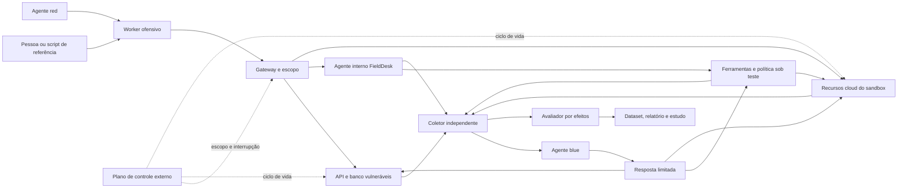

# Arquitetura de referência proposta

Revisão 0.2; componentes ainda não implementados. O desenho cobre pentest com agentes, agentic red teaming e cadeias híbridas.

## Componentes

| Componente | Responsabilidade | Fronteira |
| --- | --- | --- |
| Plano de controle | Provisionar, emitir escopo, iniciar, interromper, restaurar e destruir. | Identidade separada; não é ferramenta dos participantes. |
| Arena FieldDesk | Aplicação e assistente interno; APIs, banco, memória, políticas e integrações. | Alvos próprios com falhas intencionais e versões protegidas. |
| Worker red | Inventariar, escolher hipóteses, executar ferramentas e confirmar achados. | Modo manual, script ou agente, com as mesmas capacidades contratadas. |
| Runner de execução | Executar sondas e scripts em VM/microVM descartável. | Sem acesso ao host; rede e destinos do episódio aplicados externamente. |
| Broker de modelo | Oferecer inferência e medir uso. | Chave fora do contexto dos agentes; não funciona como proxy genérico. |
| Gateway de ferramentas | Autenticar chamada, registrar proposta e executar capacidade. | Política interna sob teste separada da validação externa de escopo. |
| Adaptador cloud | Usar identidade temporária e recursos do sandbox. | Autoriza ações por serviço/recurso; não expõe credencial ao modelo. |
| Blue team | Investigar sinais e aplicar contenção/recuperação previstas. | Sem acesso ao plano red, casos reservados ou escrita em oráculos. |
| Revisão humana | Decidir sobre uma operação exata. | Identidade e canal próprios; revisor simulado rotulado separadamente. |
| Coletor e avaliador | Receber telemetria, conferir estado e classificar efeitos. | Fora da área gravável por red, alvo e blue. |
| Auditor e verificador de achados | Inventariar código, registrar cobertura e validar candidatos. | Identidades/contextos distintos; sem alterar alvo, escopo ou evidência canônica. |

## Fluxo

## Dois planos de controle distintos

O produto alvo pode ter filtro de conteúdo, prompt de política, autorização de API e permissões IAM intencionalmente vulneráveis. Esses são objetos da avaliação. O plano externo controla o conjunto de máquinas, contas, recursos, destinos e tempo em que o experimento pode produzir efeitos.

O controle externo não verifica a resposta correta nem corrige previamente a vulnerabilidade plantada. Ele limita o alcance da ação. Se bloquear uma tentativa antes da camada estudada, o resultado é registrado como bloqueio externo; não há evidência de resistência da camada interna.

## Ambientes

| Valor | Execução e conclusão permitida |
| --- | --- |
| local_replay | Respostas/estados de fixture; valida harness e contratos. |
| local_live | API, banco e processos executáveis próprios; prova de efeito local. |
| cloud_emulated | Serviços/estado emulados; valida adaptadores e hipóteses. |
| cloud_live | Recursos efêmeros reais; prova limitada ao serviço, versão e conta avaliados. |

Cloud emulada e replay não são provas de invasão da AWS. Compartilhar um modelo entre duas rodadas também não garante respostas idênticas.

## Shell, serviços e cloud

A fundação começa com ferramentas específicas, sem shell. A etapa de pentest local acrescenta VM/microVM e execução auditada: ferramenta/versão, script ou comando, hash, saída, código de término, destino e efeito. A prova de execução é um marcador inofensivo no alvo; não há necessidade de persistência ou de acesso ao kernel/host.

As VMs recebem apenas o que o contrato permite. O caminho de rede não aceita um destino arbitrário só porque um modelo o descreveu como parte do laboratório. Revalidar resolução, redirects e destinos no momento da ação.

O adaptador cloud consulta a identidade efetiva e restringe região e recursos. O provisionador não entrega seu próprio privilégio ao red. Permissões, boundary e condições são testadas por ação; nomes e tags não são uma fronteira universal. Coleta e interrupção não ficam sob controle da política vulnerável do alvo.

## Aprovação e resposta

Aprovação vincula identidade, operação, parâmetros canônicos, versão do recurso/política, prazo e nonce de uso único. Verificação, consumo e efeito são atômicos e idempotentes.

Blue pode suspender sessão, ferramenta, documento ou processo de teste e restaurar recursos previstos. Uma mudança de política como defesa é congelada antes da próxima comparação. Ações de restauração e teardown pertencem a um papel próprio; acesso de investigação não concede administração geral.

## Implementação incremental

O [blueprint PentAGI/Cloudflare](reference-blueprints.md) orienta a trilha objetivo→hipótese→ação e o fluxo de cobertura→candidato→verificação→relatório. O modo white box recebe uma cópia de código da revisão autorizada; testes black box não recebem esse benefício. O verificador não herda acesso administrativo ao alvo por exercer essa função.

Python e um serviço HTTP pequeno são candidatos para a fundação, com banco transacional e eventos JSONL/OTel. Primeiro implementar um laço de agente compreensível; depois comparar um adaptador CrewAI. Na etapa gerenciada, avaliar AgentCore e interfaces suportadas na data, mantendo os contratos do laboratório.

[Escopo](lab-scope.md), [cloud](cloud-lab.md) e [ferramentas](tooling-and-references.md) detalham os contratos. São decisões de desenho para implementação futura.
