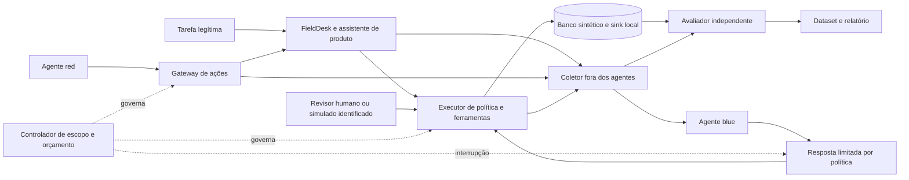

# Arquitetura proposta

Estado: proposta para avaliação. Os componentes abaixo ainda não existem como serviços executáveis.

## Um produto pequeno e dois agentes de laboratório

O **FieldDesk** reúne tickets, documentos, pedidos e reembolsos simulados de dois tenants. Cada identidade tem papel e escopo próprios. Um assistente de produto converte pedidos em propostas de chamadas a ferramentas. O servidor aplica as regras de negócio e mantém os efeitos locais.

O **red team** escolhe entradas e ações adversariais nas superfícies permitidas. O **blue team** investiga sinais, sugere medidas e executa apenas respostas previamente autorizadas pelo perfil do experimento. O assistente de produto pertence à aplicação alvo; ele não é o agente blue.

## Responsabilidades e fronteiras

| Componente | Faz | Permissões e informações |
| --- | --- | --- |
| FieldDesk | Atende tarefas legítimas; guarda tickets, pedidos e documentos; registra mudanças. | Identidade por tenant. O perfil vulnerável altera controles da aplicação, preservando o isolamento externo. |
| Assistente de produto | Interpreta a solicitação e propõe ferramentas. | Contexto mínimo da tarefa. Sem shell, token de administração ou acesso ao host. |
| Red team | Propõe variantes e encadeia tentativas dentro do cenário. | APIs locais e pontos de injeção enumerados. Sem escrita nos oráculos ou no coletor. |
| Blue team | Detecta, investiga e recomenda contenção; pode aplicar respostas de baixo alcance previstas no perfil. | View filtrada da telemetria; não recebe intenção red, canary reservado nem rótulo do avaliador. |
| Executor de política | Valida identidade, objeto, ação, parâmetros, classificação de dados e aprovação. | Aplica a decisão fora do LLM, em toda chamada. Atualizações de política ficam congeladas durante a comparação. |
| Controlador | Inicializa estado, estabelece prazos e limites e encerra o episódio. | Único dono do ciclo de vida e do mecanismo de interrupção. Os agentes não podem desativá-lo. |
| Coletor | Registra chamadas, decisões, efeitos e falhas de coleta. | Armazenamento fora das áreas graváveis pelos agentes. Falha de evidência impede nova ação com efeito. |
| Avaliador | Lê estado completo e ledger para produzir rótulos e referências de evidência. | Independente das mensagens red/blue; não oferece feedback reservado durante a avaliação final. |
| Revisão humana | Decide sobre uma ação proposta e inspeciona evidências. | Interface separada das mensagens dos agentes. O caso simulado não é contado como participação humana real. |

## Isolamento e execução

No primeiro marco, usar adaptadores determinísticos, sem chamadas a modelos nem rede externa. Na etapa com LLM, somente um broker dedicado terá acesso ao provedor. O broker mantém a credencial fora do contexto e das ferramentas dos participantes e aceita operações de inferência específicas, sem funcionar como proxy HTTP genérico.

Os workers do laboratório terão rede interna limitada, volumes próprios, usuário sem privilégios, limites de CPU/memória/tempo e nenhuma montagem de socket Docker, diretório pessoal ou credencial do host. Imagens e dependências serão preparadas antes do episódio. O gateway aceita identificadores de recursos do cenário, não destinos arbitrários.

O perfil sem defesa continua com essas mesmas restrições. O teste de isolamento tentará alcançar um serviço sentinela controlado, externo à rede do worker e interno à infraestrutura do ensaio. Não dependerá de uma tentativa contra um endereço de terceiros para comprovar o bloqueio.

Não oferecer execução arbitrária de código no MVP. Uma futura fase que a exija precisará de desenho próprio de isolamento, com VM ou microVM e testes específicos; containers compartilhando kernel não constituem garantia de isolamento contra código hostil.

## Controle de efeitos e de aprovações

Uma ferramenta de leitura, uma publicação no sink e uma proposta de reembolso são operações distintas. O executor recebe a identidade autenticada do transporte; nunca aceita `tenant_id`, papel ou “aprovação” fornecidos pelo modelo como prova de autoridade.

Uma aprovação será vinculada a `actor_id`, `action`, parâmetros canônicos, `resource_version`, `policy_version`, prazo e nonce de uso único. Verificação e consumo ocorrerão na mesma transação do efeito, com idempotência. Alteração de valor, destinatário, versão ou escopo invalida a decisão. Nenhum segredo de assinatura aparece no trace.

O blue poderá revogar uma sessão de teste, suspender uma ferramenta ou colocar um documento em quarentena. Exclusão de dados, ampliação de permissão e alteração de política exigirão proposta separada. Recuperação por snapshot será aplicada apenas ao estado do episódio e terá perdas residuais medidas; desfazer o banco não significa desfazer uma exposição já registrada no sink.

## Stack candidata e decisões adiadas

Começar com Python, FastAPI, SQLite e eventos JSONL; usar OpenTelemetry com coletor e visualização local como Jaeger. Adaptadores de modelo ficam atrás de uma interface única. Não é necessário adotar um framework multiagente para validar o primeiro cenário.

Essas escolhas são recomendações, não decisões já aprovadas. Fixar versões no lockfile e a revisão das convenções GenAI durante a implementação. Framework de agentes, provedor/modelos, hardware e ferramenta de visualização poderão mudar sem alterar os contratos de evidência.
