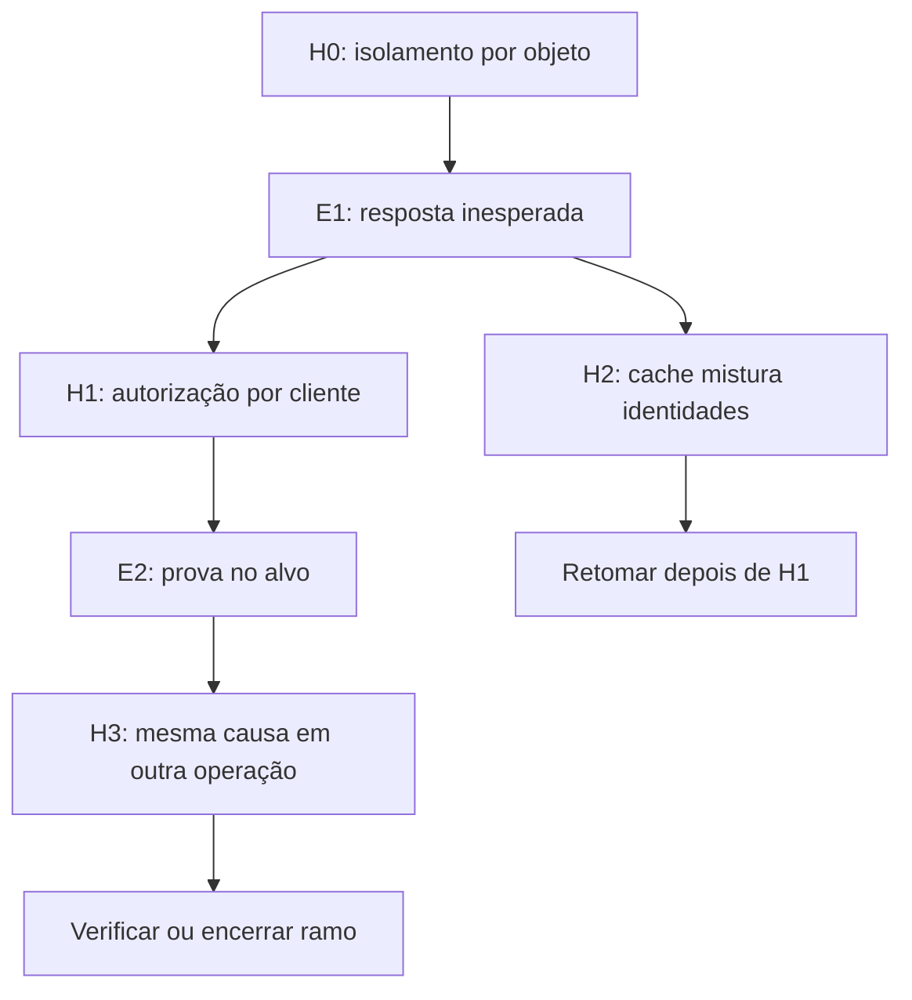

# Busca em profundidade por hipóteses

Revisão 0.3. Algoritmo e contratos propostos; execução pendente.

A OWASP — comunidade que publica guias de segurança — pode sugerir a primeira pergunta. A categoria descreve um risco; o teste deverá produzir evidência sobre o alvo.

## Ciclo da investigação

1. Criar hipótese raiz com fonte, recurso, identidade, controle esperado e resultado que a refutaria.
2. Escolher o teste permitido que mais esclareça a hipótese dentro do orçamento.
3. Registrar chamada, observação, origem, versão e evidência acessível ao papel.
4. Avaliar a observação; separar fato, interpretação e dado ainda insuficiente.
5. Propor hipóteses filhas vinculadas às observações relevantes.
6. Validar escopo, repetição e orçamento antes de expandir cada filha.
7. Explorar a filha prioritária até um término; depois retornar ao ramo anterior.
8. Preservar ramos pendentes e encaminhar alegações sustentadas ao verificador independente.

A busca em profundidade (DFS) explora primeiro cada ramo. A fila de irmãos conserva alternativas; um ramo bloqueado permite retornar a outro ramo elegível.



O exemplo representa um desenho de investigação. Cada transição precisa de prova própria; a árvore ilustrativa permanece sem resultado medido.

## Evidência e estado

| Registro | Significado |
| --- | --- |
| Fonte de referência | Categoria ou método que motivou a pergunta. |
| Observação | Resposta, registro ou estado obtido por canal identificado. |
| Hipótese | Explicação testável, com pré-condições e possibilidade de refutação. |
| Alegação de achado | Candidato com evidência suficiente para revisão independente. |
| Achado confirmado | Verificador comprova fronteira, condições e efeito. |

Uma observação pode gerar várias explicações. Um texto hostil pode propor novas hipóteses, mas o controlador continua responsável por aprovar seu alcance.

| Estado da hipótese | Tratamento |
| --- | --- |
| `proposed` | Aguardando elegibilidade e teste. |
| `testing` | Teste em andamento. |
| `supported` | Evidência apoia a hipótese; achado ainda exige verificação. |
| `refuted` | Evidência contradiz a hipótese. |
| `inconclusive` | Dados insuficientes para decidir. |
| `blocked` | Controle ou pré-condição impede o teste. |
| `pruned` | Repetição ou limite encerrou o ramo. |
| `deferred` | Ramo preservado para investigação posterior. |
| `not_executed` | Exemplo ilustrativo de formato. |

Identificar nós por recurso, identidade, ação, versão e fronteira. O fingerprint detecta repetições; novas evidências podem justificar reabertura registrada.

Se dois ramos convergirem, conservar referências entre os nós. A visualização pode parecer árvore, mas o registro admite relações de grafo.

## Limites e parada

Congelar profundidade, filhos, nós, chamadas, tempo e custo antes do episódio. O controlador aplica limites locais e globais, incluindo subtarefas delegadas.

Exemplo de configuração proposta para revisão:

```json
{
  "max_depth": 4,
  "max_children_per_node": 3,
  "max_nodes": 40,
  "max_tool_calls": 80,
  "max_duration_seconds": 900
}
```

Esses números ilustram o contrato. O orçamento efetivo virá da configuração congelada, sem autorizar gasto por este documento.

Ao esgotar um limite, registrar a fronteira restante como pendente. Cobertura parcial permanece explícita no relatório.

Uma hipótese filha herda o escopo externo do episódio. Um recurso externo ao contrato exige novo planejamento pelo responsável.

Resultados anteriores podem orientar o próximo teste. Achados passados exigem revalidação na revisão atual; memória reservada fica separada das campanhas de desenvolvimento.

## Dataset e comparação

Gravar `hypotheses.jsonl` conforme o [schema](../schemas/hypothesis.schema.json). Registrar pais, profundidade, fundamento, teste, evidências e decisão humana aplicável.

Usar `plan.revised` nos eventos existentes, com `hypothesis_id`, `parent_hypothesis_id` e referências no payload. Chamadas e efeitos mantêm seus eventos próprios.

O manifesto registra esse artefato com `kind: other`. Os contratos anteriores continuam em 0.2; o contrato novo de hipótese usa 0.3.

Medir nós testados, apoiados, refutados, repetidos e pendentes. Medir custo até a primeira prova e ganho por nova evidência.

Comparar DFS com roteiro fixo sob os mesmos limites. Um orçamento exaurido descreve o alcance observado, sem provar ausência de falhas.

O avaliador mantém seus oráculos reservados. O red expande hipóteses apenas com as observações permitidas ao seu papel.
